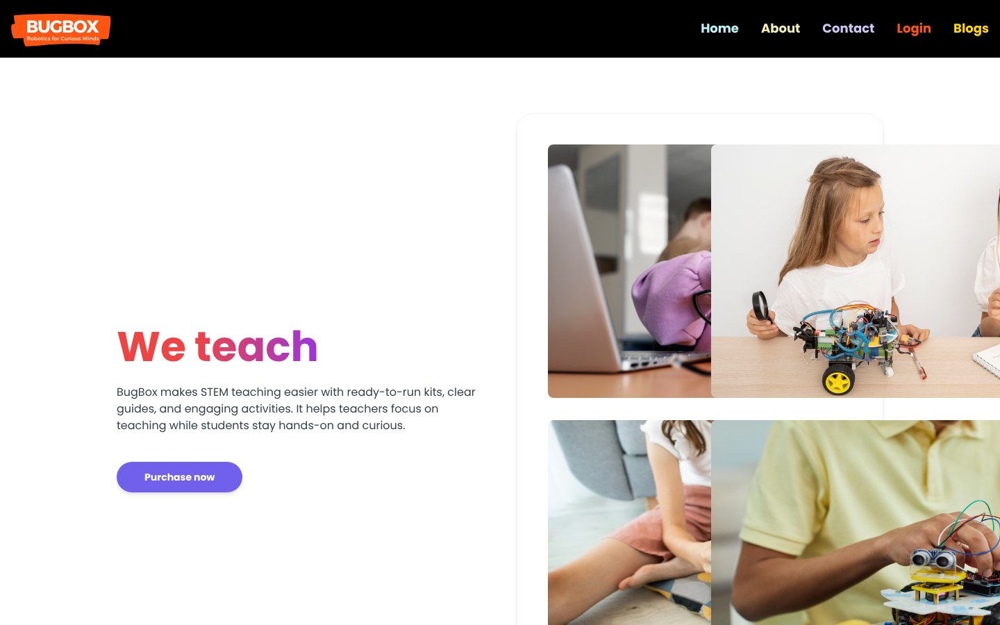
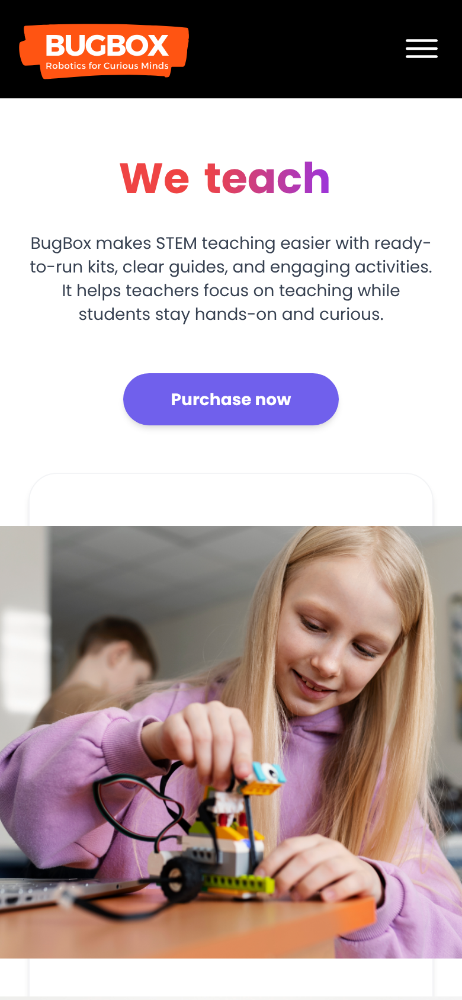
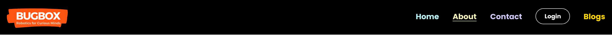
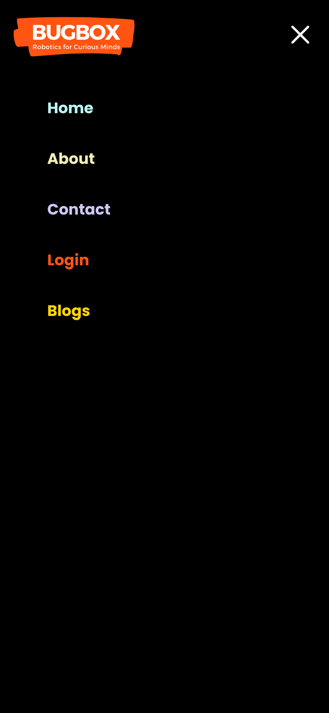
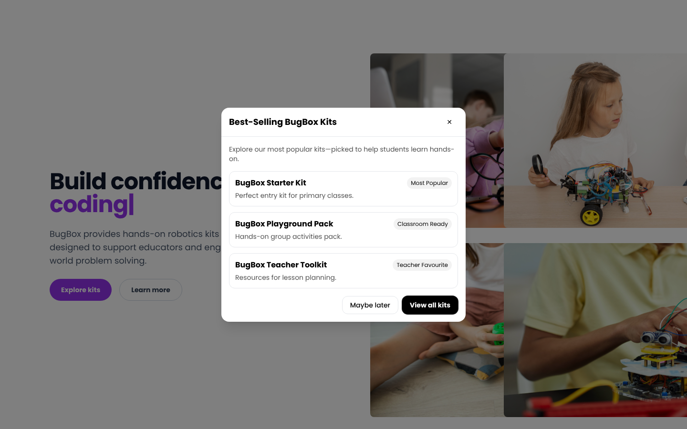
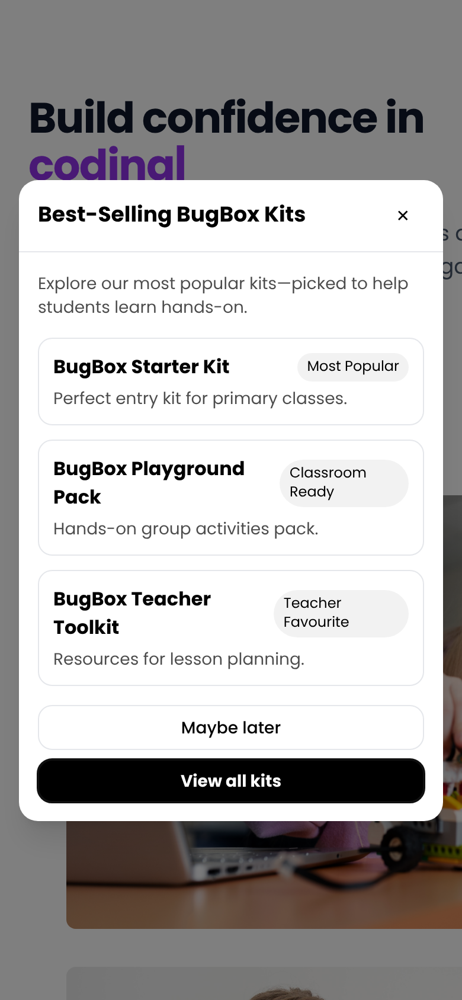

# BugBox – My Front-End Contributions

**BugBox** is an educational platform that helps teachers deliver STEM and digital-technology lessons using hands-on robotics kits. The website was built by a student team at **Redback Operations**, Deakin University's capstone company.

The full team codebase lives in a private organisation repository. This repo showcases **the features I designed and built** between December 2025 and February 2026.

## At a glance

| | |
|---|---|
| **Role** | Front-end developer |
| **Stack** | React 18 · JavaScript · Tailwind CSS · React Router · Jest · Playwright |
| **Workflow** | 5 feature branches, 17 commits, pull requests into the team repo, conventional commit messages |
| **Focus** | UI polish, responsive layout, accessibility, user engagement |

---

## 1. Homepage hero redesign (Task 5)

I reworked the homepage hero section to give it a clearer visual hierarchy and a stronger call to action.

- Rebuilt the layout as a two-column section that stacks cleanly on mobile, with consistent spacing and a max-width container
- Animated "We teach / simplify / make it easy!" headline with a red-to-purple gradient
- Redesigned the **Purchase now** CTA: pill shape, brand purple, hover lift and shadow, and a visible keyboard focus ring
- Framed the image collage in a soft card so it reads as one unit

| Desktop | Mobile |
|---|---|
|  |  |

Code: [`HeroHeader.jsx`](code-samples/HeroHeader.jsx)

## 2. Navigation bar enhancement

- Turned **Login** into an outlined pill button so the main action stands out from the regular links
- Added hover feedback to links (slight scale and underline) using one shared style
- Moved the nav config out of the component so it isn't recreated on every render
- Fixed a mobile usability issue: the slide-out menu now **closes automatically** when a link is tapped

Code: [`Navbar.jsx`](code-samples/Navbar.jsx)

## 3. Best-selling kits popup with engagement tracking

A first-visit popup that promotes BugBox's best-selling kits and sends interested visitors to the shop.

- Shows three featured kits with badges (Most Popular, Classroom Ready, Teacher Favourite)
- **View all kits** goes straight to the shop; **Maybe later** dismisses it
- **Remembers the dismissal** so returning visitors aren't shown it again. It saves to `localStorage`, `sessionStorage` *and* a cookie, with every storage call wrapped in `try/catch` so it still works in private browsing or when storage is blocked
- Added a follow-up banner component so visitors who dismissed the popup still have a low-pressure link to the kits later (progressive disclosure)

| Desktop | Mobile |
|---|---|
|  |  |

Code: [`BestSellerPopup.jsx`](code-samples/BestSellerPopup.jsx) · [`BestSellerBanner.jsx`](code-samples/BestSellerBanner.jsx)

## 4. Reusable accessible modal component

Instead of building the popup as a one-off, I created a shared `Modal` component the rest of the team can reuse. It follows accessibility best practice for dialogs:

- `role="dialog"`, `aria-modal` and `aria-labelledby` so screen readers announce it correctly
- **Focus trap**: Tab and Shift+Tab cycle inside the dialog
- Moves focus into the dialog on open and **restores focus** to the previous element on close
- Closes with **Escape**, the ✕ button, or a click on the backdrop (configurable)
- Locks background scrolling while open

Code: [`Modal.jsx`](code-samples/Modal.jsx)

## 5. Testing and team workflow

- Fixed the Jest test for `App` by wrapping it in a `MemoryRouter` so components that use routing render correctly in tests
- Added a Playwright configuration for browser tests with video and trace recording
- Resolved merge conflicts in `Header` and `BestSellerPopup` while keeping both my changes and teammates' work intact
- Kept each feature on its own branch (`feature/task-5-ui-polish`, `feature/navbar-ui-enhancement`, `feature/hero-cta-animation`, `feature/homepage-popup`, `feature/popup-engagement-tracking`)

## What I learned

- Working inside an existing team codebase: reading other people's code, following their conventions, and resolving conflicts carefully
- Building accessible UI components, not just visual ones
- Designing for mobile first with Tailwind's responsive utilities
- Thinking about user experience beyond the happy path, e.g. what happens when storage is blocked, or when someone dismisses a popup but wants to come back to it

---

*Code samples are the components I wrote for the project, shared for portfolio purposes. Screenshots were captured from a local build of my feature branches.*
